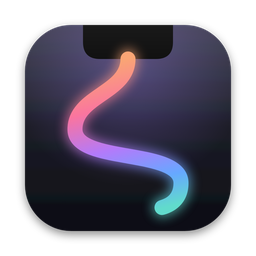

<p align="center">
	
</p>

# Contributing to NotchFlow

Thanks for wanting to help. Bug reports, ideas, fixes, translations and design work are all welcome.

## Reporting a bug or an idea

Open an issue at https://github.com/dhruvv620/notchflow/issues. For a bug, say what you did, what you expected and what happened, and attach the zip from **Export Logs** (NotchFlow's Tools menu) if you can.

## Code of Conduct

Please read the [Code of Conduct](CODE_OF_CONDUCT.md) before taking part.

## Development setup

- macOS 14.6 or later on Apple silicon, ideally a MacBook with a notch.
- Xcode 26 or later, and [Git LFS](https://git-lfs.com) for the animation assets.

```bash
git clone https://github.com/dhruvv620/notchflow.git
```
```bash
cd notchflow && bash Build.command && open -a NotchFlow
```

`Build.command` runs the regression checks in `tests/`, builds and signs a Debug copy, and installs it. You can also open `DynamicIsland.xcodeproj`, choose the **DynamicIsland** scheme and **My Mac**, and press Command-R. (The project and folder are still called DynamicIsland; the app they build is NotchFlow.)

## Making a change

1. Fork the repository and create a branch: `git switch -c feature/your-feature`.
2. Keep each change focused, and follow the existing style: Swift API Design Guidelines, small views, and logic that can be tested kept in Foundation-only files under `DynamicIsland/helpers/` with a regression test in `tests/`.
3. Adding or changing a setting? Read [docs/SETTINGS.md](docs/SETTINGS.md) first; `tests/test_settings_integrity.py` checks its rules.
4. Run `bash Build.command` and make sure it finishes without errors.
5. For anything that runs in the background, compare `bash tools/energy-report.sh 5 before` and `… 5 after` (CPU, energy impact, idle wake-ups, memory).
6. Describe the change for users in the Unreleased section of [CHANGELOG.md](CHANGELOG.md).
7. Open a pull request with what changed and why, and screenshots or a short recording for anything visible.

## Design

Keep to the macOS Human Interface Guidelines and the shared components in `NotchDesignKit.swift`, so tabs look and behave alike. The app icon's source is `docs/assets/AppIcon.svg`.

## Translations

User-facing text lives in `DynamicIsland/Localizable.xcstrings`; edit it in Xcode's String Catalog editor.

## License

By contributing, you agree that your contributions are licensed under the [GNU General Public License v3](LICENSE).

Thanks for helping make NotchFlow better!
