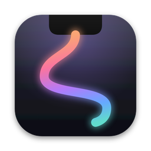

<p align="center">
  
</p>
<h1 align="center">NotchFlow</h1>
<p align="center">Your MacBook notch, turned into a home for music, timers, messages, AI agents and quick tools.</p>

<p align="center">
  <a href="https://github.com/dhruvv620/notchflow/releases/latest"></a>
  
  
  <a href="LICENSE"></a>
</p>

NotchFlow stays out of the way until you need it. Hover over the notch (or swipe down) and it opens into tabs; while it is closed, it shows what matters right now: the song that is playing, a running timer, the next meeting, an agent waiting for you.

## What's in the notch

- **Music**: Apple Music, Spotify, YouTube Music and more, with synced lyrics (also under the closed notch), what plays next, and gesture controls.
- **Timers and focus**: timers, Pomodoro with a weekly history and streak, optional Focus switching, and a distraction meter that notices when you drift to YouTube or X.
- **Calendar and Todos**: today's events, Reminders as todos (drop text, links or files to add one), a progress ring for today, and meeting cards with a Join button and a countdown.
- **Notifications, WhatsApp and calls**: every app's notifications in one inbox with inline replies, WhatsApp chats through a local gateway, and incoming calls with the caller's photo and quick replies.
- **AI agents**: approve Claude Code, Codex, Cursor and Gemini CLI from the notch, follow what they are doing, read and continue their conversations, and start new tasks without opening a terminal.
- **Clipboard and Shelf**: clipboard history you can swipe through, and a shelf for files with quick actions (resize, PDF, cut out, zip, AirDrop, WhatsApp).
- **Smart tools**: copy a tracking number, date, address or flight and the notch offers the right action; smart replies with your own MiniMax key; a build watcher for GitHub Actions; people pins.
- **Cuely**: a teleprompter for your scripts that listens and follows your voice.
- **System**: replacement HUDs for volume, brightness and keyboard backlight, battery and charging, Bluetooth devices, privacy indicators, downloads, lock screen widgets, and system stats.

Everything can be switched on or off and rearranged in Settings.

## Install

Paste this into Terminal:

```bash
curl -fsSL https://github.com/dhruvv620/notchflow/releases/latest/download/install.sh | bash
```

Or download [NotchFlow.dmg](https://github.com/dhruvv620/notchflow/releases/latest/download/NotchFlow.dmg), open it and drag NotchFlow into Applications. NotchFlow is not notarized by Apple, so the first time you open it from the DMG, macOS blocks it: go to System Settings > Privacy & Security and click **Open Anyway**. The Terminal line does not need this.

NotchFlow needs an Apple silicon Mac with macOS 14.6 or later. It works best on a MacBook with a notch; on other displays it shows a floating island instead.

**Updates**: NotchFlow checks once a day, and **Check for Updates…** is in the menu bar icon and in Settings > About.

**Permissions**: macOS asks the first time a feature needs something (Accessibility for the HUDs and gestures, Calendar and Reminders, Camera for the mirror, Microphone and Speech Recognition for Cuely, Full Disk Access for the notification inbox). Allow only the ones you want. [docs/PRIVACY.md](docs/PRIVACY.md) explains what each one is used for.

## Getting around

- Hover over the notch to open it, or swipe down with two fingers when hover-to-open is off; swipe up to close.
- Swipe left or right with two fingers to switch tabs. In the clipboard, a three-finger page swipe turns the page.
- Settings > Tabs & Features chooses which tabs appear and in what order.
- Add files to the Shelf from Terminal: `open -a NotchFlow /path/to/file`.

## Troubleshooting

- After granting Accessibility or Screen Recording, quit and reopen NotchFlow.
- If stats are empty, turn on the categories in Settings > Stats.
- If music controls don't respond, check that the player is running and that NotchFlow may control it (System Settings > Privacy & Security > Automation).
- For a bug report, **Export Logs** in NotchFlow's Tools menu saves its logs and crash reports to a zip file.

## Building from source

You need Xcode 26 or later and [Git LFS](https://git-lfs.com) (for the animation assets).

```bash
git clone https://github.com/dhruvv620/notchflow.git
```
```bash
cd notchflow && bash Build.command && open -a NotchFlow
```

`Build.command` runs the regression checks, builds a Debug copy, signs it with your Apple Development certificate when you have one (so permissions survive rebuilds), and installs it. The full output is in `Build.log`. To get later changes: `git pull --ff-only && bash Build.command`.

Your Mac keeps one NotchFlow: a development build from `Build.command` replaces the released copy, and the next release (or Check for Updates) replaces it again. Development builds don't check for updates.

## Publishing a release (maintainer)

One time:
1. `brew install gh`, then `gh auth login` (GitHub.com, HTTPS, log in with a browser).
2. Have an Apple Development certificate (Xcode > Settings > Accounts > Manage Certificates). Check with `security find-identity -v -p codesigning`.

Every release:
1. Commit and push your changes, and describe them in the Unreleased section of [CHANGELOG.md](CHANGELOG.md).
2. Run `bash Release.command` (or `bash Release.command 1.2.0` to pick the version; otherwise it uses `VERSION` or the next patch).

It builds and signs NotchFlow, makes `NotchFlow.dmg` and `NotchFlow.zip`, signs the update with a key kept in your login Keychain (created on the first release; back it up as it tells you), publishes a GitHub release with `appcast.xml` (which everyone's Check for Updates reads), and installs the released copy on your Mac.

## Documentation

- [docs/SETTINGS.md](docs/SETTINGS.md): how Settings is organized and the rules for adding a setting.
- [docs/AGENTS.md](docs/AGENTS.md): how the AI agent integration works.
- [docs/PRIVACY.md](docs/PRIVACY.md): what NotchFlow accesses and where your data stays.
- [CONTRIBUTING.md](CONTRIBUTING.md) and [CHANGELOG.md](CHANGELOG.md).

## License

NotchFlow is free software under the [GNU General Public License v3](LICENSE). [NOTICE](NOTICE) lists the projects it is based on and their copyrights.

## Acknowledgments

NotchFlow builds on these open-source projects and services:

- [boring.notch](https://github.com/TheBoredTeam/boring.notch): the notch app this code base grew from (media player, shelf, calendar and notch interaction).
- [Stats](https://github.com/exelban/stats): CPU temperature, frequency and per-core usage readings.
- [rtaudio](https://github.com/ZephyrCodesStuff/rtaudio): the live music visualizer.
- [SwiftTerm](https://github.com/migueldeicaza/SwiftTerm): the Terminal tab.
- [SkyLightWindow](https://github.com/Lakr233/SkyLightWindow): windows for the lock screen widgets.
- [DynamicNotch](https://github.com/jackson-storm/DynamicNotch): battery HUD designs.
- [OpenUsage](https://github.com/robinebers/openusage): LLM usage tracking.
- [GOWA](https://github.com/aldinokemal/go-whatsapp-web-multidevice): the WhatsApp gateway.
- [Sparkle](https://sparkle-project.org): updates.
- [Open-Meteo](https://open-meteo.com) for weather and [OpenRouter](https://openrouter.ai) for model pricing.
- Alcove inspired the minimalistic layout, and Wick the lock screen timer design.
